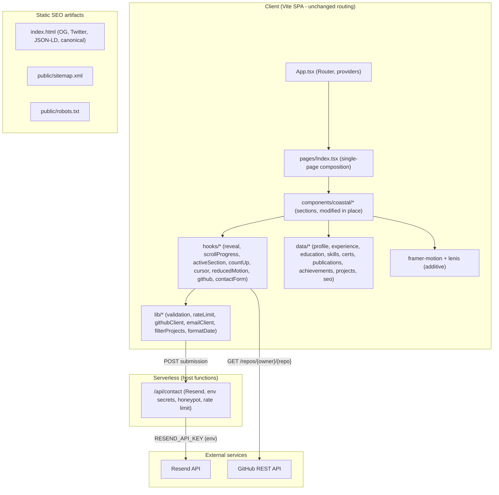

# Design Document

## Overview

This design describes the upgrade of the existing React + TypeScript + Vite portfolio at `keshav-ai-portfolio` into a complete, premium presentation of Kesavardhan Makireddi's work. It is an **evolution of the current template, not a rebuild**. Every architectural decision preserves the existing Coastal design language, folder structure, routing, single-page composition, and the CSS-transition motion system that is already in place.

The upgrade is organized into six concerns that map directly onto the requirements:

1. **Content correctness** — replace all placeholder studio content (Mizen Head, "Stand at the edge", "Coastal Design Studio", "Esports Tournaments", etc.) with the Owner's real resume- and project-derived content, sourced only from the `Resume_Source` and `Project_Dataset`.
2. **A shared data layer** — lift the currently inline, per-component arrays into typed data modules (`src/data/*`) so that every Coastal component renders from a single, authoritative source and content is never duplicated.
3. **A richer, accessible animation system** — extend the existing `useScrollReveal`/IntersectionObserver approach with a small set of hooks (scroll progress, active section, count-up, custom cursor) and an additive `framer-motion` + Lenis layer, all gated behind `prefers-reduced-motion`.
4. **Hardened contact + email delivery** — move email delivery behind a serverless endpoint that reads credentials from environment variables, with client + server validation, honeypot, and rate limiting.
5. **SEO + metadata** — replace Lovable placeholders in `index.html`, add Open Graph / Twitter / JSON-LD Person structured data, canonical URL, `sitemap.xml`, and `robots.txt`.
6. **GitHub integration, performance, accessibility, responsiveness** — cross-cutting concerns applied across the existing sections.

The design deliberately keeps the number of moving parts small: existing components are modified in place, new logic lives in pure, testable modules (`src/lib/*`) and hooks (`src/hooks/*`), and the section composition in `src/pages/Index.tsx` is preserved.

### Research Notes and Key Decisions

- **Animation library (additive).** The requirements (R5) call for text reveal, staggered entrance, blur/scale/mask reveals, scroll progress, count-up, custom cursor, animated backgrounds, and smooth scrolling at 60fps using GPU-accelerated properties. The current CSS-transition system already covers reveal/stagger/blur. To meet the richer requirements without discarding existing motion, this design introduces **`framer-motion`** (declarative transform/opacity animation, built-in `useReducedMotion`, GPU-friendly) and **`lenis`** (smooth in-page scrolling). Both are additive — existing `.reveal-text`/`.stagger-in`/`.blur-in` classes and the `useScrollReveal` hook continue to function unchanged. Framer Motion animates `transform`/`opacity` only, satisfying R5.12.
- **Email delivery (secrets off the client).** R6.10 requires provider credentials to live in environment variables and never ship in client source. The current EmailJS integration hardcodes service/template/public keys in `CoastalContact.tsx`, which cannot satisfy R6.10 for a secret API key, and client-only EmailJS cannot enforce server-side rate limiting (R6.8). The design therefore routes submissions through a **serverless function** (`/api/contact`, deployed as a Vercel Function) that calls **Resend** using `RESEND_API_KEY` from the server environment, performs server-side honeypot + rate-limit enforcement, and returns a JSON result. If a serverless runtime is unavailable in the target host, the same client contract is satisfied by a hardened Formspree endpoint (URL only, no secret) as a fallback; EmailJS is retired because it cannot keep a secret key server-side.
- **GitHub metadata.** R10 requires live repo metadata (language, updated date, topics, stars, forks) with graceful static fallback and no visible error. The design uses the **public GitHub REST API** (`GET /repos/{owner}/{repo}`) via `@tanstack/react-query` (already a dependency) with a 5s timeout, caching, and a silent fallback to static `Project_Dataset` content.
- **No new routes / no new section components.** R1.1/R1.2 forbid route changes and section-rendering components outside `src/components/coastal/*`. All new UI primitives (scroll-progress bar, custom cursor, animated background, mobile nav) are either global overlays composed inside existing Coastal components / the layout, or small helpers under `src/components/ui/*` and `src/hooks/*` — never new section components.

## Architecture

The application remains a single-page React app served by Vite, with one React Router route (`/`) rendering `src/pages/Index.tsx`, which composes the Coastal section components in their existing order. The upgrade adds three horizontal layers beneath the existing components: a **data layer**, a **logic layer** (`src/lib`), and a **hooks layer** (`src/hooks`).



### Layering rules

- **Coastal components** own layout, Coastal styling, and composition. They read from `data/*` and delegate all non-trivial logic to hooks/lib. They contain no hardcoded content arrays after the upgrade.
- **Hooks** adapt browser/runtime state (intersection, scroll position, media queries, query results) into React state. They are the only place that touches `window`, `IntersectionObserver`, `matchMedia`, or network fetches from the client.
- **Lib** modules are pure, framework-free functions (validation, filtering, rate-limit accounting, date formatting, GitHub response mapping). These are the primary property-testing surface.
- **Serverless** owns email delivery and secret handling.

### Motion architecture

`framer-motion` is introduced through a thin wrapper convention rather than a rewrite:

- A `useReducedMotion` hook (wrapping `matchMedia('(prefers-reduced-motion: reduce)')`) is the single source of truth for motion gating. Every animated hook and component reads it and, when reduced motion is on, renders content in its final static state and disables background motion, counters, cursor motion, and entrance reveals (R5.11, R8.6, R4.10).
- Lenis is initialized once at the layout level and drives smooth in-page anchor scrolling (R5.10). When reduced motion is on, Lenis is initialized with instant scrolling (or not started), and native scrolling is preserved.
- Existing CSS-transition reveals stay as-is; new richer reveals (scale, mask) use Framer Motion variants that animate only `transform`/`opacity`.

## Components and Interfaces

All section components already exist under `src/components/coastal/*` and are **modified in place** (R1.4). No section component is added, removed, or renamed. New non-section primitives are global overlays or `ui/*` helpers.

### Existing Coastal components (modified in place)

| Component | Section id | Change summary |
|---|---|---|
| `CoastalNavbar` | nav | Replace "Coastal"/studio links with Owner wordmark and real section links; add fixed active-section indication (R5.4), mobile nav affordance ≥44px with disclosure (R11.4/11.5), and `role="navigation"`/`aria-label` (R8.7). |
| `CoastalHero` | `home` | Replace studio copy with name, "AI Engineer / Software Engineer" title, headline, intro (R4.1); add GitHub/LinkedIn/email links (R4.2/4.3), `Resume_Button` download (R4.4/4.5), `Availability_Badge` (R4.7), contact scroll control (R4.6), optional profile portrait treatment (R4.9), intro animation gated by reduced motion (R4.8/4.10). |
| `CoastalWork` | `work` | Render from `projects` data; used as the compact index of selected work; real stat values only. |
| `CoastalManifesto` | `manifesto` | Replace studio manifesto lines with a resume-derived professional summary statement (R2.1); keep line-reveal motion. |
| `CoastalCases` | `cases` | Becomes the **Projects_Section**: render all 30 projects with name, description, category, tech stack (R3.1/3.2); category filter control (R3.6–3.9); repo/live links with `target="_blank" rel="noopener noreferrer"` (R3.3–3.5, 3.10/3.11); GitHub metadata badges (R10). |
| `CoastalExperience` | `experience` | Render from `experience` data; correct employer names/roles/locations/dates; reverse-chronological order (R2.2/2.3). |
| `CoastalSkills` | `skills` | Render the nine resume category headings with their skills (R2.5). |
| `CoastalEducation` | `education` | Render two education entries, IIM Visakhapatnam first (R2.4). |
| `CoastalCertifications` | `certifications` | Render all eight certifications with issuer (R2.6). |
| `CoastalPublications` | `publications` | Render the IEEE 2026 publication with title + venue (R2.7). |
| `CoastalAchievements` | `achievements` | Replace non-resume entries with Top 5 Hackbyte 3.0 and Top 10 Workato AI Automation Hackathon (R2.8). |
| `CoastalContact` | `contact` | Full form (name/email/message) with validation, honeypot, loading state, success animation, copy-email control; submits via `emailClient` → `/api/contact` (R6). |
| `CoastalFooter` | — | Replace studio wordmark/footer content with Owner branding and real links; **remove the duplicate `id="contact"`** so the Contact section owns that anchor. |

The `Projects_Section` responsibility (R3) is assigned to `CoastalCases` (grid with rich cards and filtering); `CoastalWork` remains a lightweight "selected work" index that links into the projects section. This keeps one canonical projects renderer (R1.4) and avoids duplicating project content (R1.5).

### New hooks (`src/hooks/*`)

```typescript
// useReducedMotion.ts — single source of truth for motion gating (R5.11, R8.6, R4.10)
export function useReducedMotion(): boolean;

// useScrollProgress.ts — vertical scroll progress 0..1 for the progress indicator (R5.3)
export function useScrollProgress(): number; // clamped to [0, 1]

// useActiveSection.ts — id of the section currently in view for navbar indication (R5.4)
export function useActiveSection(sectionIds: string[]): string;

// useCountUp.ts — animates a numeric value once when visible (R5.5)
export function useCountUp(target: number, opts?: { durationMs?: number; enabled?: boolean }): number;

// useCustomCursor.ts — pointer-capable-only custom cursor state (R5.6, R5.7)
export function useCustomCursor(): { enabled: boolean; position: { x: number; y: number } };

// useGitHubRepo.ts — live repo metadata with 5s timeout + silent static fallback (R10)
export function useGitHubRepo(repoUrl?: string): {
  data: GitHubRepoMeta | null;   // null while loading or on failure
  isError: boolean;              // consumed internally; never surfaced to the visitor
};

// useContactForm.ts — form state, validation, honeypot, submission lifecycle (R6)
export function useContactForm(): {
  values: ContactFormValues;
  errors: Partial<Record<keyof ContactFormValues, string>>;
  status: 'idle' | 'submitting' | 'success' | 'error' | 'rate_limited';
  setField: (field: keyof ContactFormValues, value: string) => void;
  submit: () => Promise<void>;
};
```

### New logic modules (`src/lib/*`) — pure and testable

```typescript
// validation.ts — Zod schema + pure validators (R6.1, R6.6)
export const contactSchema: z.ZodType<ContactFormValues>;
export function validateContact(values: ContactFormValues): ValidationResult;
export function isValidEmail(email: string): boolean; // non-empty local, single '@', domain with a dot

// filterProjects.ts — pure category filtering (R3.6–3.9)
export function distinctCategories(projects: Project[]): Category[];
export function filterByCategory(projects: Project[], category: Category | 'all'): Project[];

// rateLimit.ts — rolling-window accounting used by the serverless endpoint (R6.8)
export function isRateLimited(history: number[], now: number, opts?: { windowMs?: number; max?: number }): boolean;
export function recordSubmission(history: number[], now: number, windowMs?: number): number[]; // prunes old entries

// githubClient.ts — pure mapping of the GitHub API response to our model (R10.1, R10.5)
export function mapRepoResponse(raw: unknown): GitHubRepoMeta;   // normalizes, clamps counts >= 0
export function parseRepoUrl(url: string): { owner: string; repo: string } | null;

// formatDate.ts — human-readable calendar date (R10.1)
export function formatUpdatedDate(iso: string): string;

// emailClient.ts — client transport to the serverless endpoint (R6.2, R6.5)
export function sendContact(payload: ContactSubmission): Promise<SendResult>; // 30s timeout
```

### New UI primitives (global overlays, not sections)

- `ScrollProgressBar` (`components/ui/`) — fixed top bar bound to `useScrollProgress` (R5.3).
- `CustomCursor` (`components/ui/`) — pointer-only glow/magnetic follower bound to `useCustomCursor` (R5.6/5.7).
- `AnimatedBackground` (`components/ui/`) — aurora/gradient-mesh treatment gated by reduced motion (R5.9/5.11).
- Mobile nav disclosure inside `CoastalNavbar` using the existing `Sheet`/`Drawer` primitive (R11.4/11.5).

These are composed at the layout boundary (inside existing components or around `<main>` in `Index.tsx` without adding routes), keeping R1.1/R1.2 intact.

### Serverless endpoint

```
POST /api/contact
Request  (application/json): { name, email, message, website /* honeypot */ }
Behavior:
  1. If honeypot `website` is non-empty  -> 200 { ok: true } (silently dropped, Resend NOT called) [R6.7]
  2. Re-validate name/email/message server-side                                                   [R6.6]
  3. Rate limit by client key (IP) over rolling 10-min window, max 5 -> 429 { rateLimited: true } [R6.8]
  4. Send via Resend using RESEND_API_KEY (env)                                                    [R6.2, R6.10]
Response: 200 { ok: true } | 400 { error, field } | 429 { rateLimited: true } | 500 { error }
```

## Data Models

All content is lifted into typed modules under `src/data/*`. Each module is the single source of truth for its section (R1.5). Content originates only from the `Resume_Source` and `Project_Dataset` (R1.6/1.7); on conflict, project content follows the `Project_Dataset` and all other content follows the `Resume_Source` (R1.8).

```typescript
// data/types.ts

export type Category = string; // e.g. "Real-time Detection & Surveillance", "LLM & RAG Applications"

export interface Project {
  id: string;
  name: string;
  description: string;
  category: Category;
  techStack: string[];
  githubUrl?: string;   // under github.com/keshav-077 when present (R3.3)
  liveUrl?: string;     // present only when a deployment exists (R3.4, R3.10)
}

export interface Experience {
  company: string;      // Course5i | Infoteck Solutions | IIIT Nagpur
  role: string;
  location: string;
  startDate: string;    // ISO or YYYY-MM for reverse-chronological sort (R2.3)
  endDate: string;
  bullets: string[];
}

export interface Education {
  institution: string;  // IIM Visakhapatnam | IIIT Nagpur
  program: string;
  startYear: number;
  endYear: number;
  description?: string;
}

export interface SkillCategory {
  title: string;        // one of the nine resume headings (R2.5)
  skills: string[];
}

export interface Certification { title: string; issuer: 'NVIDIA' | 'IBM' | 'Udemy'; } // eight entries (R2.6)

export interface Publication { title: string; venue: string; year: number; url?: string; } // IEEE 2026 (R2.7)

export interface Achievement { title: string; badge: string; description?: string; }       // Hackbyte, Workato (R2.8)

export interface Profile {
  name: string;
  title: string;                 // "AI Engineer / Software Engineer"
  headline: string;
  summary: string;               // professional summary (R2.1)
  availability: 'Available' | 'Open to opportunities' | 'Unavailable'; // (R4.7)
  email: string;                 // keshavardhan777@gmail.com
  githubUrl: string;             // github.com/keshav-077
  linkedinUrl: string;           // keshavardhan-m-9b8a22314
  resumePath: string;            // /Keshavardhan_Makireddi.pdf
  profileImage?: string;         // optional portrait (R4.9)
}

export interface GitHubRepoMeta {
  language: string | null;
  updatedAt: string;             // human-readable via formatUpdatedDate (R10.1)
  topics: string[];              // may be empty -> no topics list (R10.5)
  stars: number;                 // >= 0 (R10.1)
  forks: number;                 // >= 0 (R10.1)
  isPublic: boolean;             // open-source badge (R10.4)
}

// Contact
export interface ContactFormValues { name: string; email: string; message: string; website: string; /* honeypot */ }
export type SendResult = { ok: true } | { ok: false; reason: 'validation' | 'rate_limited' | 'delivery' };
```

### SEO data model (`data/seo.ts`)

```typescript
export interface SeoConfig {
  canonicalUrl: string;          // single absolute canonical (R7.5)
  ogTitle: string;               // <= 60 chars (R7.1)
  ogDescription: string;         // <= 160 chars (R7.1)
  ogImage: string;               // absolute (R7.1)
  twitterHandle: string;         // replaces @Lovable (R7.6)
  twitterImage: string;          // absolute (R7.2)
  person: { name: string; jobTitle: string; sameAs: string[] }; // JSON-LD Person (R7.3)
}
```

`index.html`, `public/sitemap.xml`, and `public/robots.txt` are generated/edited to match `SeoConfig`, with all "Lovable" values and Lovable-hosted image URLs removed (R7.6).

### Data integrity constraints

- `projects.ts` contains exactly 30 entries (R3.1); every entry has a non-empty `name`, `description`, `category`, and at least one `techStack` item (R3.2).
- `distinctCategories(projects)` lists each category exactly once and drives the filter control plus the "all" option (R3.6).
- `experience.ts` holds the three real roles, sorted reverse-chronological by `startDate` (R2.2/2.3); `education.ts` holds two entries with IIM first (R2.4); `skills.ts` holds the nine headings (R2.5); `certifications.ts` holds eight entries (R2.6).
- No module contains placeholder studio content after the upgrade (R1.6); optional fields absent in the source are omitted rather than filled with placeholder characters (R2.9, R3.10/3.11, R10.5).

## Correctness Properties

*A property is a characteristic or behavior that should hold true across all valid executions of a system — essentially, a formal statement about what the system should do. Properties serve as the bridge between human-readable specifications and machine-verifiable correctness guarantees.*

These correctness properties apply to this feature's **pure logic layer** — content-data integrity, project filtering, form validation, rate-limit accounting, GitHub response mapping, SEO metadata generation, and the pure math behind the animation hooks (scroll progress, count-up, motion gating). UI layout, timing/frame-rate, visual treatment, and external-service delivery are covered by example, edge-case, integration, and smoke tests in the Testing Strategy rather than property-based tests, per the prework classification.

The properties below reflect the redundancy consolidation from the prework reflection.

### Property 1: No placeholder content in rendered data or metadata

*For any* entry across every content data module (`profile`, `experience`, `education`, `skills`, `certifications`, `publications`, `achievements`, `projects`) and *for any* generated SEO metadata value, no field value contains a token from the placeholder blocklist (`"Mizen Head"`, `"Coastal Design"`, `"Stand at the edge"`, `"Esports"`, `"Lovable"`, `lovable.app`, and Lovable-hosted image domains).

**Validates: Requirements 1.6, 7.6**

### Property 2: Reverse-chronological ordering of dated entries

*For any* list of dated entries (work experiences or education entries), the ordering function produces a list in which every entry's start date is greater than or equal to the start date of the entry that follows it.

**Validates: Requirements 2.3, 2.4**

### Property 3: Experience rendering completeness

*For any* experience dataset, the rendered Experience section contains, for every entry, its employer, role title, location, and date range.

**Validates: Requirements 2.2**

### Property 4: Skills rendering completeness

*For any* skills dataset, the rendered Skills section contains every category heading and, under it, every skill string listed for that category.

**Validates: Requirements 2.5**

### Property 5: Certifications rendering completeness

*For any* certifications dataset, the rendered Certifications section contains, for every entry, its title and its issuer.

**Validates: Requirements 2.6**

### Property 6: Omitted optional fields render no placeholder

*For any* content entry whose optional field is absent, the rendered output contains neither placeholder characters nor an empty field element in that field's position.

**Validates: Requirements 2.9, 10.5**

### Property 7: All projects render with complete detail

*For any* project dataset, the rendered Projects section displays exactly one card per project (card count equals dataset length) and each card contains the project name, description, category, and every tech-stack item.

**Validates: Requirements 3.1, 3.2**

### Property 8: Optional project links mirror the data

*For any* project, a repository link is rendered if and only if the project has a `githubUrl`, and a deployment link is rendered if and only if the project has a `liveUrl`; when a URL is absent, no link and no broken-link placeholder is rendered.

**Validates: Requirements 3.3, 3.4, 3.10, 3.11**

### Property 9: External links open safely in a new tab

*For any* rendered external link (project repository, project deployment, Hero GitHub, Hero LinkedIn), the anchor has `target="_blank"` and a `rel` attribute containing both `noopener` and `noreferrer`.

**Validates: Requirements 3.5, 4.3**

### Property 10: Distinct category enumeration

*For any* project dataset, `distinctCategories` returns a list containing each category present in the dataset exactly once and no category absent from the dataset.

**Validates: Requirements 3.6**

### Property 11: "All" filter is the identity

*For any* project dataset, filtering by the all-projects option returns exactly the full dataset (the default on first load and after clearing a filter).

**Validates: Requirements 3.7, 3.9**

### Property 12: Category filter soundness and completeness

*For any* project dataset and *for any* category `c` present in it, filtering by `c` returns exactly the projects whose category equals `c` — every returned project has category `c`, and no project with category `c` is omitted.

**Validates: Requirements 3.8**

### Property 13: Availability badge shows exactly one allowed state

*For any* `profile.availability` value, the Hero renders exactly one availability badge whose text is one of `"Available"`, `"Open to opportunities"`, or `"Unavailable"`.

**Validates: Requirements 4.7**

### Property 14: Scroll progress is a clamped, monotonic mapping

*For any* scroll position (`scrollTop`, `scrollHeight`, `clientHeight`), `useScrollProgress` returns a value in `[0, 1]` that equals `0` at the top of the document and `1` at the bottom, and never decreases as `scrollTop` increases.

**Validates: Requirements 5.3**

### Property 15: Active section is always a known section

*For any* set of section offsets and *for any* scroll position, `useActiveSection` returns an id drawn from the provided set of section ids.

**Validates: Requirements 5.4**

### Property 16: Count-up stays within bounds and terminates at the target

*For any* target value and *for any* animation progress `p` in `[0, 1]`, the count-up value lies between the start value and the target, equals the start value at `p = 0`, and equals the target exactly at `p = 1`.

**Validates: Requirements 5.5**

### Property 17: Custom cursor enabled exactly for pointer-capable devices

*For any* device-capability flag, the custom cursor is enabled if and only if the device is pointer-capable; touch-only devices retain the native pointer.

**Validates: Requirements 5.6, 5.7**

### Property 18: Reduced motion yields static final state

*For any* animated hook, when reduced motion is enabled, the count-up returns its target immediately, reveal/entrance state resolves to fully visible, animated-background and cursor motion are disabled, and all content remains present and accessible.

**Validates: Requirements 5.11, 8.6, 4.10**

### Property 19: Contact validation soundness

*For any* contact form values, `validateContact` reports the submission valid if and only if the name length is in `[1, 100]`, the email length is in `[1, 254]` and the email has a non-empty local part, a single `@` separator, and a domain containing at least one dot, and the message length is in `[1, 2000]`; when invalid, the result identifies the offending field and the submission is not sent.

**Validates: Requirements 6.1, 6.6**

### Property 20: Honeypot submissions are dropped without contacting the email service

*For any* submission whose honeypot field is non-empty, the submission is rejected and the email transport (client `sendContact` / Resend) is never invoked.

**Validates: Requirements 6.7**

### Property 21: Rolling-window rate limiting

*For any* history of submission timestamps and *for any* current time, `isRateLimited` returns true if and only if the number of submissions within the trailing 10-minute window exceeds 5; timestamps outside the window are ignored and stop contributing once the window advances past them.

**Validates: Requirements 6.8**

### Property 22: SEO metadata generation constraints

*For any* valid `SeoConfig`, the generated Open Graph and Twitter tags satisfy: `og:type` is `"website"`, `twitter:card` is `"summary_large_image"`, both titles are at most 60 characters, both descriptions are at most 160 characters, and all URL/image values are absolute URLs.

**Validates: Requirements 7.1, 7.2**

### Property 23: JSON-LD Person structured data validity

*For any* person configuration, the generated structured data parses as valid JSON and contains `@type` `"Person"`, a name, a job title, and at least one `sameAs` profile URL.

**Validates: Requirements 7.3**

### Property 24: Accessible names for images and icon-only controls

*For any* rendered image, the `alt` attribute is present — non-empty for non-decorative images and empty for decorative images — and *for any* rendered icon-only interactive control, a non-empty accessible name (`aria-label` or equivalent) is present.

**Validates: Requirements 8.3, 8.4**

### Property 25: Palette color pairings meet WCAG AA contrast

*For any* foreground/background color pairing used for text in the Coastal palette, the contrast ratio is at least 4.5:1 for normal text and at least 3:1 for large-scale text and essential UI components.

**Validates: Requirements 8.5**

### Property 26: GitHub response mapping normalizes counts and dates

*For any* raw GitHub repository API response, `mapRepoResponse` yields a star count and fork count that are non-negative integers and an `updatedAt` rendered in a human-readable calendar date format.

**Validates: Requirements 10.1**

### Property 27: GitHub failure falls back to static content silently

*For any* GitHub retrieval failure mode (network error, 5-second timeout, or rate-limit exceeded), the corresponding project renders using its static `Project_Dataset` content, retains that content, and no error indication is shown to the visitor.

**Validates: Requirements 10.3**

### Property 28: Open-source badge reflects repository visibility

*For any* retrieved repository metadata, the open-source badge is displayed if and only if the repository is public.

**Validates: Requirements 10.4**

## Error Handling

The design centralizes fallible operations in the logic/hooks layer and defines a deterministic outcome for each failure so the visitor never sees a broken state.

| Failure | Location | Handling | Requirement |
|---|---|---|---|
| Resume PDF cannot be retrieved | Hero `Resume_Button` | Attempt download; on failure show an inline "resume unavailable" message and stay on the current view (no navigation) | R4.5 |
| Contact validation failure | `useContactForm` / `validation.ts` | Block submission, surface a per-field message identifying the invalid field | R6.6 |
| Honeypot filled | `useContactForm` + `/api/contact` | Silently accept the UI action but never call Resend; server also drops it | R6.7 |
| Email delivery failure or >30s timeout | `emailClient.sendContact` | Reject with `reason: 'delivery'`; form shows error and retains entered values | R6.5 |
| Rate limit exceeded | `/api/contact` (`rateLimit.ts`) | Return 429; form shows "rate limit exceeded" and prevents further sends until the window resets | R6.8 |
| GitHub request error / timeout / rate limit | `useGitHubRepo` | Silent fallback to static project content, no visitor-facing error; retain static content until a later success | R10.3 |
| SEO image URL unresolved | build/static metadata | Retain all other metadata values without omission or substitution | R7.7 |
| Below-fold image / off-viewport section | lazy loading | Reserve layout space to avoid CLS; load when within 300px of the viewport | R9.1, R9.5, R9.8 |
| Web font still loading | CSS `font-display: swap` | Render fallback font, swap when the web font loads | R9.4 |

Client-side errors are surfaced through the existing `sonner`/`toaster` primitives already provided in `App.tsx`, keeping the Coastal look consistent. The serverless endpoint returns structured JSON (`{ ok } | { error, field } | { rateLimited }`) that the client maps to form state.

## Testing Strategy

The project already has **Vitest**, **@testing-library/react**, **@testing-library/jest-dom**, and **jsdom** configured (`src/test/setup.ts`). The upgrade adds **`fast-check`** as the property-based testing library for the pure-logic properties above. Property tests must not be implemented from scratch — `fast-check` provides the generators and shrinking.

### Dual testing approach

- **Property tests (fast-check)** — one property-based test per correctness property (Properties 1–28), each running a **minimum of 100 iterations**. These cover data integrity, filtering, validation, rate limiting, GitHub mapping, SEO generation, accessibility-name invariants, palette contrast, and the pure animation math.
- **Unit / example tests** — specific behaviors that are not universal: Hero content presence (R2.1, R4.1/4.2/4.4/4.6), publication and achievements presence and Esports absence (R2.7, R2.8), contact success/failure/loading lifecycle (R6.3/6.4/6.5), copy-email (R6.9), navbar landmark and mobile disclosure (R8.7, R11.5), canonical/sitemap/robots artifacts (R7.4/7.5), focus-indicator contrast computation (R8.2), and lazy-loading/font-swap attributes (R9.1/9.4/9.8).
- **Edge-case tests** — reduced-motion two-state rendering (R4.10), scroll-triggered one-time entrance via a mocked `IntersectionObserver` (R5.2), unresolved SEO image (R7.7).
- **Integration tests (1–3 examples)** — contact endpoint delivery with a mocked Resend client (R6.2) and GitHub success-within-timeout with a mocked fetch (R10.2). These do not vary meaningfully with input, so they are not property tests.
- **Smoke tests** — single route composition (R1.1/1.2/1.4), design-token snapshot (R1.3), no client-shipped secret (R6.10), and code-split chunk presence (R9.3).
- **Manual / tooling verification** — Lighthouse CI on a production build for Performance/Accessibility/Best-Practices/SEO ≥95, LCP ≤2.5s, CLS <0.1, and 60fps profiling (R5.13, R9.5–9.7); horizontal-overflow checks across 320–1920px (R11.6); keyboard-navigation and screen-reader review (R8.1). Full WCAG 2.1 AA conformance requires manual testing with assistive technologies and expert review beyond automated checks.

### Property test configuration

- Library: `fast-check` with Vitest.
- Minimum **100 iterations** per property test.
- Each property test is tagged with a comment referencing its design property in the format:
  `// Feature: portfolio-upgrade, Property {number}: {property_text}`
- Generators produce realistic domain data: `Project` records (with/without optional URLs), `Experience`/`Education` lists with random dates, `ContactFormValues` (including boundary lengths and malformed emails), timestamp histories for rate limiting, raw GitHub responses (including negative/missing counts and empty topics), and `SeoConfig` values.

### Unit testing balance

Example tests are kept minimal and focused on concrete behaviors, integration points, and error/edge conditions; broad input coverage is delegated to the property tests so the suite stays fast and meaningful.
